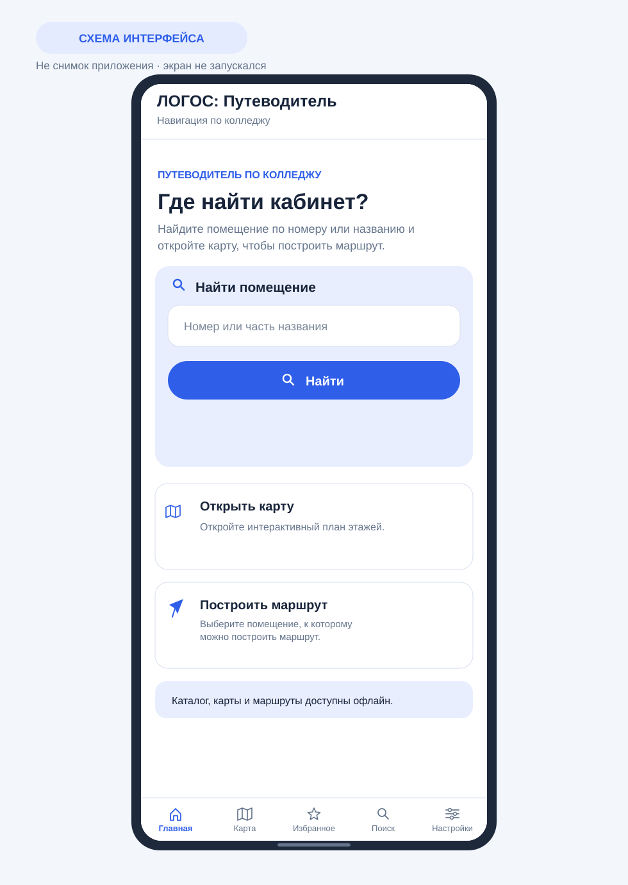
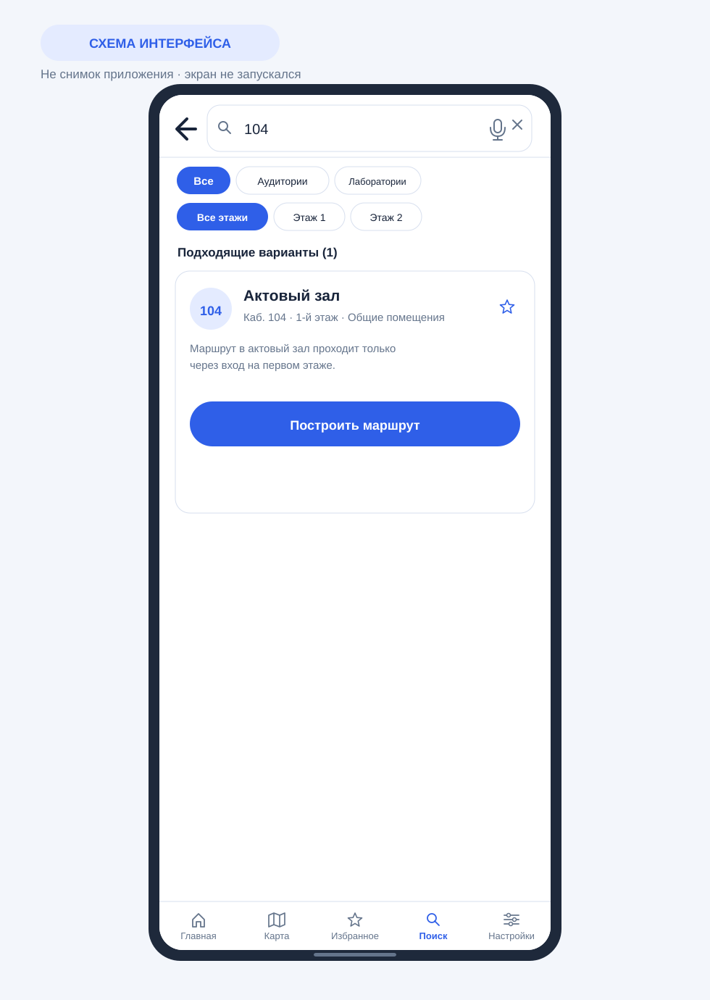
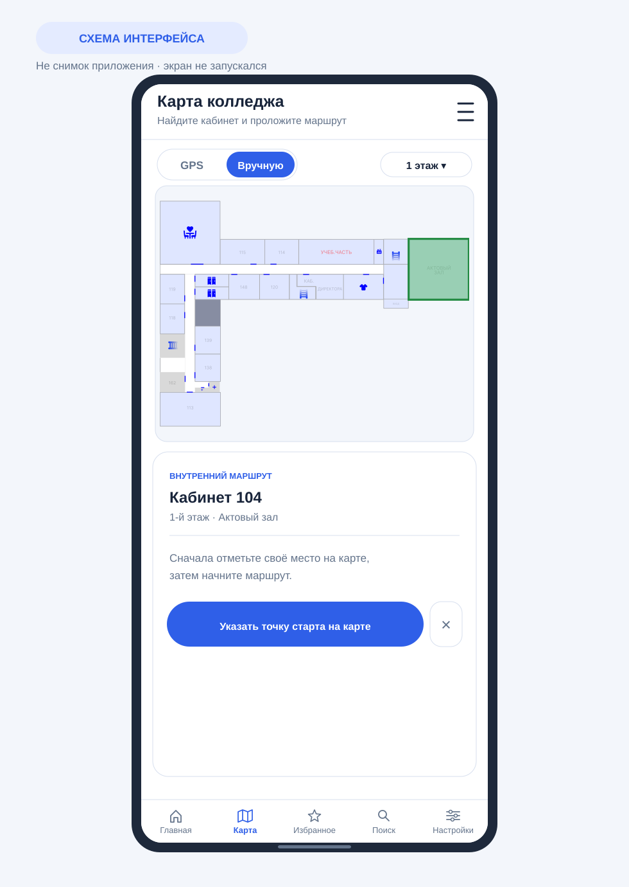
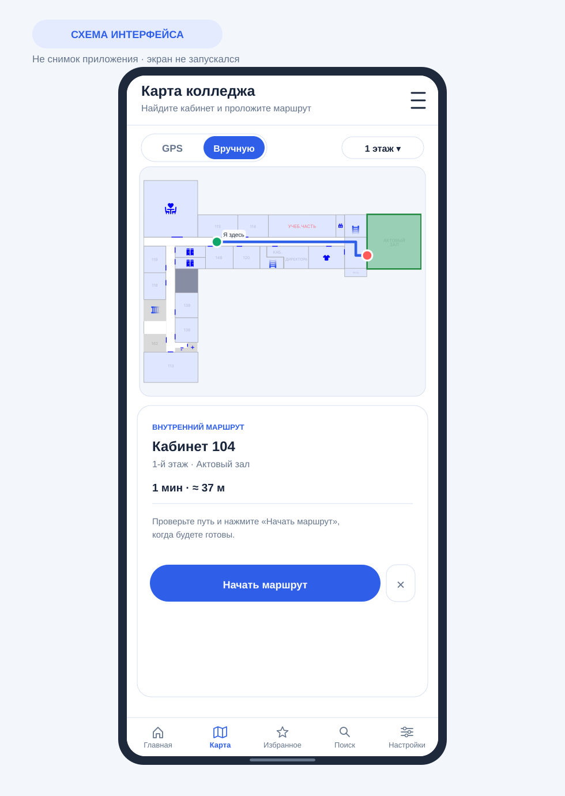
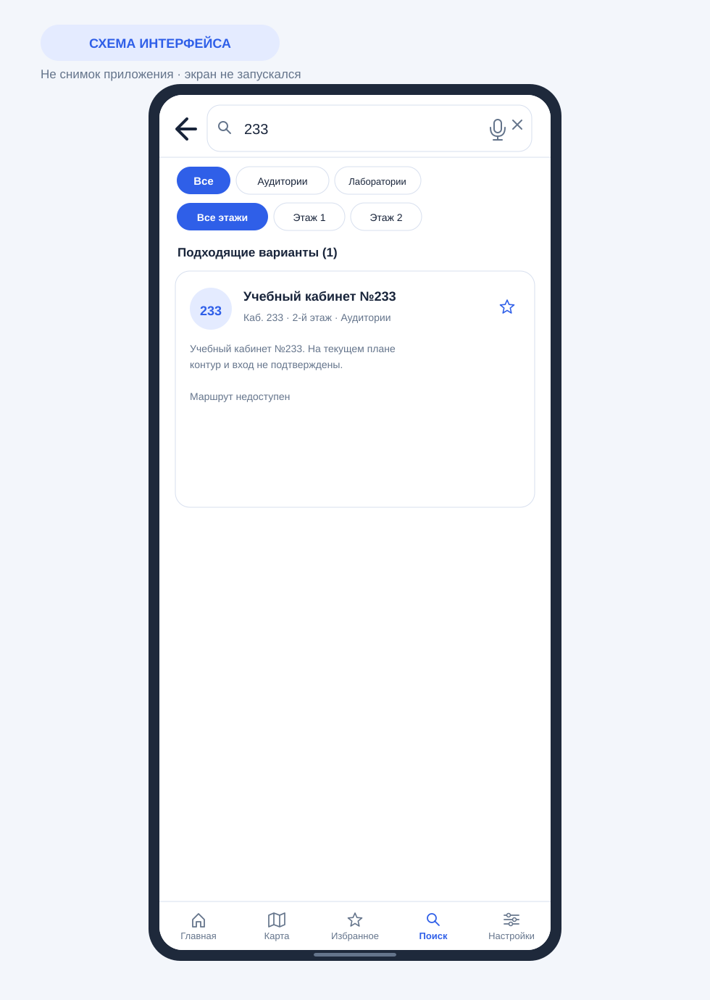
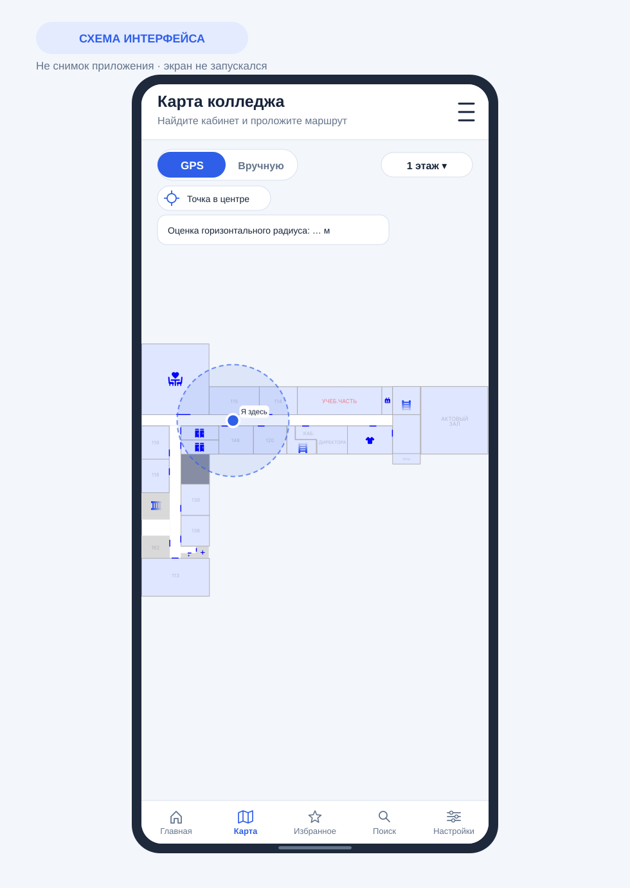

# Руководство пользователя «ЛОГОС: Путеводитель»

Это руководство сверено с Compose-экранами и локальными данными проекта. Приложение в этой проверке не запускалось: все изображения ниже — **схемы интерфейса, не скриншоты**. Тексты и основные действия сверены с исходниками; положение отдельных элементов на схеме условно. В схемах карты использован локальный план первого этажа. Маркер GPS и примерная ручная точка не являются реальными измерениями или местоположением пользователя; личные координаты не приводятся.

## Первый запуск

Мастер первого запуска позволяет выбрать язык и предпочтение для межэтажных переходов. Разрешение на геолокацию необязательно: его можно не выдавать и пользоваться ручной отметкой положения. Отказ от разрешения не запрещает открыть каталог, план этажей или поиск.

Основные разделы приложения: **Главная**, **Карта**, **Избранное**, **Поиск** и **Настройки**. Экран **О приложении** открывается из настроек или меню карты.

## Найти помещение

1. На **Главной** введите номер или часть названия и нажмите **«Найти»**. Такой же каталог доступен во вкладке **«Поиск»**.

   

   *Схема главного экрана по `HomeScreen.kt`; приложение на устройстве не запускалось.*

2. В поиске при необходимости отфильтруйте записи по категории или этажу. Например, запрос **104** находит «Актовый зал» на первом этаже. У карточки есть действие **«Построить маршрут»**, если маршрут для записи разрешён локальными данными.

   

   *Подпись и описание помещения взяты из локальной записи `room_104`. В данных для него задан вход на первом этаже; это не подтверждение фактической доступности прохода на месте.*

   Нажатие на строку помещения открывает его на плане; кнопка **«Построить маршрут»** выбирает его как назначение. В отдельном режиме выбора назначения показываются только записи с настроенным маршрутом. Голосовой ввод открывает системное распознавание речи Android: приложение просит предпочесть офлайн-распознавание, но не может гарантировать наличие такого системного компонента или работу без сети.

## Открыть карту и начать маршрут

После выбора маршрутно-доступного назначения откроется карта соответствующего этажа. Если подходящей точки старта ещё нет, панель маршрута сообщит об этом и предложит **«Указать точку старта на карте»**.

*Подсвеченная область взята из локального плана. Схема показывает состояние без известной точки старта; конкретное положение пользователя не задано.*

### Установить старт вручную

1. Выберите режим **«Вручную»**. Разрешение на геолокацию для этого не требуется.
2. В панели маршрута нажмите **«Указать точку старта на карте»**. В режиме выбора приложение подсказывает нажать на план; допустима размеченная область помещения или коридора.
3. Нажмите на доступное место плана. После принятого нажатия появится маркер **«Я здесь»**, а при уже выбранном назначении приложение пересчитает маршрут.
4. Проверьте этаж и направление. Если путь рассчитан, панель покажет оценочные расстояние и время; нажмите **«Начать маршрут»**, когда готовы.

*Полилиния и значения статически восстановлены по правилам `SiteIndoorRouter` для условной точки в коридоре на первом этаже. Расстояние использует `metersPerUnit` плана; время рассчитано при стандартной скорости 4 км/ч (это значение по умолчанию, его можно изменить в настройках). Интерфейс округляет длину до целого метра и минуты вверх. Это модельный расчёт из исходников, не результат запуска приложения или полевого измерения. Планировщик использует заданные в коде связи коридоров и дверей; схема не подтверждает реальные проходы и доступность входа.*

В ручном режиме GPS не отслеживает перемещение: после начала маршрута переходите по шагам кнопками **«Предыдущий шаг»** и **«Следующий шаг»** и сверяйтесь с указателями. На карту нельзя поставить старт за пределами известной геометрии, в закрытой зоне или в помещении, где маршрут не поддерживается. Если путь не построен, проверьте место старта и доступность выбранного назначения.

У некоторых записей маршрутизация отключена, потому что в данных не подтверждены контур помещения или вход. Например, обычный поиск оставляет видимым кабинет 233, но показывает, что маршрут недоступен:

*Согласно локальной записи `room_233`, на текущем плане не подтверждены контур и вход. Это ограничение данных приложения, а не утверждение, что помещения нет в здании. В режиме выбора назначения такая запись отфильтровывается.*

Маршрут может автоматически рассчитаться при выборе назначения, если уже есть точка положения и включена соответствующая настройка. Проверяйте каждый маршрут по плану и указателям. Локальная геометрия и расчётные расстояния не проверены полевыми измерениями и не гарантируют актуальное состояние здания.

## GPS и оценочный радиус

В режиме **GPS** приложение запрашивает местоположение через Android/Google Play services при выданном разрешении и включённых службах геолокации. На карте может отображаться сообщённая провайдером оценка горизонтального радиуса и, если включён соответствующий параметр, круг вокруг маркера.

*Многоточие вместо числа — поясняющий заполнитель схемы. В работающем приложении число зависит от конкретного измерения и провайдера; круг на иллюстрации не в масштабе.*

Этот радиус — оценка, сообщённая провайдером Android (`Location.accuracy`), а не измеренная внутри здания ошибка и не гарантия, что реальное положение лежит внутри окружности. Статус «точность в пределах порога» означает только прохождение проверки приложения; он не доказывает indoor-точность.

Во время GPS-ведения маршрутный прогресс рассчитывается проекцией измеренной точки на линию пути. В текущем коде, если отклонение от линии не превышает 6 м, отображаемый маркер также может быть перемещён к ней; тогда и круг провайдерской оценки рисуется вокруг смещённого маркера. Это map matching, а не новое измерение и не повышение точности. Не считайте маркер, совпавший с линией, подтверждением фактического положения; сверяйтесь с планом и указателями.

Внутри здания GPS может быть слабым, смещённым или отсутствовать. При неизвестной/невалидной оценке или превышении установленного приложением порога автоматическое построение и продвижение по маршруту не подтверждаются; при очень большой оценке маркер может быть скрыт. Дождитесь свежей точки либо переключитесь на ручную отметку. GPS не измеряет этаж: проверяйте этаж по указателям и используйте доступные в интерфейсе выбор/подтверждение этажа. Автоматические действия у перехода между этажами основаны на программной проверке маршрута и горизонтальной проекции, а не на измерении высоты; не полагайтесь на них вместо проверки на месте.

Измерения принимаются только в пределах заданного возраста: устаревшая точка отбрасывается; если текущая точка становится старше двух минут при открытом приложении, GPS-маркер и построенный маршрут сбрасываются до нового измерения. Для GPS-маршрута требуется свежая точка с сообщённой оценкой в пределах порога. Если включён автоматический переход в ручной режим при плохом GPS, приложение может переключить режим после точки с отсутствующей или превышающей порог оценкой.

GPS и компас работают, пока приложение на переднем плане. В фоне GPS-запросы останавливаются; при возвращении старый GPS-маркер и состояние ведения очищаются, пока приложение ожидает новую точку. В настройках можно выбрать приоритет запроса, интервал обновления (1–10 секунд), порог (5–50 м), показ круга и автоматический переход в ручной режим. Это параметры запроса и поведения программы, а не настройка или подтверждение фактической GPS-точности. Частые запросы и включённый компас могут расходовать заряд; сравнительные измерения батареи не проводились.

## План и своё положение

Карта — нативный интерактивный план двух этажей с локальными помещениями и маршрутными данными; внешняя картографическая подложка не используется. Масштабируйте и перемещайте план, выберите этаж и нажмите на помещение, чтобы открыть его карточку.

В ручном режиме разрешение на геолокацию не нужно. Чтобы переместить уже установленный маркер, используйте действие **«Переместить точку»** и нажмите в новом допустимом месте. Маркер можно установить внутри размеченного помещения, если оно поддерживается навигацией. Некоторые помещения и закрытые зоны не принимаются как старт.

## Избранное, история и резервный JSON

В разделе **«Избранное»** доступны вкладки **«Помещения»**, **«История»** и **«Маршруты»**. Можно добавлять помещения, создавать папки, переименовывать и упорядочивать записи, удалять их и повторять сохранённые маршруты. История включается настройкой и ограничивается её лимитом. Эти данные хранятся локально на устройстве.

Кнопки экспорта и импорта JSON находятся на экране избранного. Экспорт включает папки/категории, избранные помещения, историю и сохранённые маршруты; **настройки приложения в него не входят**. Импорт добавляет отсутствующие записи, а не восстанавливает весь телефон и не возвращает настройки. Код импорта поддерживает схемы 1–2, но перенос в будущий APK должен быть отдельно проверен.

### Важно перед переустановкой

Удаление приложения может стереть избранное, папки, историю, сохранённые маршруты, настройки и другие данные, закрытые внутри приложения. Android Backup для этого перехода не проверялся и не гарантируется.

Перед удалением старой версии сначала экспортируйте JSON в общую папку, например «Документы» или «Загрузки», и проверьте в файловом менеджере, что файл существует и открывается. Если экспорт не удался или файл нельзя проверить вне данных приложения — **не удаляйте старую версию**. После публикации устанавливайте только официальный целевой APK; импортируйте файл лишь после подтверждения совместимости импортёра именно этого APK.

## Офлайн-работа, разрешения и приватность

Каталог, планы и построение маршрутов используют локальные данные и доступны без запроса к картографическому серверу. Сам GPS зависит от системных служб, разрешения и доступности провайдера на телефоне; работа геолокации без сети для конкретного устройства не гарантируется. Автообновление требует подключения к GitHub. Системное распознавание речи и выбранное внешнее приложение для передачи текста могут иметь собственные сетевые и приватностные условия.

Координаты GPS используются в памяти приложения для нанесения точки на план. В проверенном коде они не записываются в Room/DataStore и не включаются в JSON-экспорт; найденные вызовы диагностического журнала не содержат широту/долготу, а файловое логирование по умолчанию выключено. Сформированный текст передачи сообщает этаж/помещение, а не сырые координаты. Это описание кода приложения, а не обещание о действиях Android, Google Play services или выбранного внешнего приложения.

Bluetooth-позиционирование, BLE-маяки, внешний GNSS-приёмник и связь «телефон—телефон» в проекте не реализованы. Bluetooth-соединение само по себе не задаёт абсолютную координату. Не используйте это руководство как подтверждение наличия маяков или другой инфраструктуры.

## Обновления и статус версии

Экран **«О приложении»** содержит встроенную проверку обновлений. Она обращается к GitHub Releases; автоматическая проверка ограничивается интервалом 24 часа, ручная доступна из About. Проверка сама по себе не устанавливает APK: загрузка начинается после действия пользователя, затем открывается системный установщик Android с подтверждением. Если Android запросит разрешение на установку из этого источника, его нужно разрешить в системных настройках.

По сверке исходников и GitHub Releases API на 2026-10-12 `1.0.1-release` — **разрабатываемая, не опубликованная** версия; официальный APK, Git-тег и Release этой версии не найдены. Проверенный `origin/main` `394361783557c5e578ec05b6a20fe40541bcf436` задаёт `1.1.0-release` и `versionCode 4` в исходниках, что не подтверждает выпуск такого APK. Встроенный клиент сравнивает числовые части `versionName`, не проверяет `versionCode` или сертификат APK; текущий GitHub Latest tag `release` не разбирается этим сравнением и может выглядеть в UI как «Установлена последняя версия» без успешного сравнения. Поэтому не полагайтесь на эту надпись как на подтверждение наличия или отсутствия целевого `1.0.1`.

APK выпускает владелец проекта вручную через Android Studio. Изменение или слияние исходного кода само по себе не собирает и не публикует пользовательский APK. Подробные ограничения версии, updater-а и перехода приведены в [инструкции по сборке](BUILD_APK_RU.md), а подтверждённые возможности и их статус — в [каталоге функций](FEATURES.md).

## Что проверено

Текст сверён с исходниками [`HomeScreen`](../app/src/main/java/com/logos/navigator/ui/HomeScreen.kt), [`MapScreen`](../app/src/main/java/com/logos/navigator/ui/map/MapScreen.kt), [`CanvasMapView`](../app/src/main/java/com/logos/navigator/ui/map/CanvasMapView.kt), [`SearchScreen`](../app/src/main/java/com/logos/navigator/ui/search/SearchScreen.kt), [`MainViewModel`](../app/src/main/java/com/logos/navigator/ui/MainViewModel.kt), [`SiteIndoorRouter`](../app/src/main/java/com/logos/navigator/navigation/SiteIndoorRouter.kt), GPS-потоком [`FusedLocationTracker`](../app/src/main/java/com/logos/navigator/data/location/FusedLocationTracker.kt), локальными `rooms.json`/`navigation_graph.json` и SVG плана первого этажа. Разметка иллюстраций основана на этих источниках; UI приложения, установленный APK, фактический импорт/экспорт, работа GPS на устройстве и полевые измерения не запускались.
